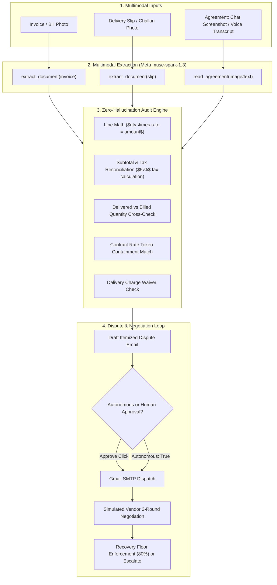

# BillBack

> Small shops and families pay bills where the real agreement lives in a voice note or chat, the proof of delivery is a paper slip, and the bill is a photo. There's no ERP and no contract system. Overcharges slip through (wrong math, fees nobody agreed to, items billed twice or never delivered) because checking means cross-referencing three messy sources by hand, and disputing means writing and chasing emails. BillBack is an agent that reads all three, proves each overcharge with arithmetic, and carries the dispute through to recovery.

---

## 30-Second Architecture: How It Works



---

## Quickstart (Fresh Clone Setup)

1. **Clone the repository**:
   ```bash
   git clone https://github.com/Manasa-L-Hegde/billback.git
   cd billback
   ```

2. **Create virtual environment & install dependencies**:
   ```bash
   python -m venv .venv
   # Windows:
   .venv\Scripts\activate
   # macOS/Linux:
   source .venv/bin/activate

   pip install -r requirements.txt
   ```

3. **Configure environment variables**:
   Create a `.env` file from `.env.example`:
   ```env
   MODEL_API_KEY=your_meta_model_api_key_here
   # Optional: Real Gmail sending (defaults to DRY_RUN=1 audit outbox logging)
   DRY_RUN=1
   GMAIL_USER=your_email@gmail.com
   GMAIL_APP_PASSWORD=your_16_char_app_password
   DEMO_VENDOR_EMAIL=vendor_inbox@example.com
   ```

4. **Launch the Web Application**:
   ```bash
   uvicorn server:app --reload
   ```
   Open `http://127.0.0.1:8000` in your browser.

---

## How to Try the Demo Case (One-Click)

1. Open `http://127.0.0.1:8000`.
2. Click the **"Try Demo Case"** button on the top right of the inputs card.
   - Automatically loads `test_bill5.jpg` and `test_slip5.jpg` (duplicate billing case).
   - Audits the bill live via Server-Sent Events (SSE).
   - Flags ₹780 duplicate Cooking Oil + ₹39 tax on overcharge = **₹819.00 total claim**.
   - Initiates negotiation with the simulated vendor, counters an interim 50% offer, and settles at 100% recovery.

---

## Honesty and Limitations

- **Synthetically Generated Test Data**:
  - Sample invoices (`test_bill1.jpg` to `test_bill6.jpg`), delivery slips (`test_slip*.jpg`), and chat screenshots (`test_chat1.jpg` to `test_chat3.jpg`) are synthetic test data generated with deliberate arithmetic errors and discrepancies for testing.
  - The 4 historical invoices for *City Wholesale Mart* in the sidebar are seeded test data to demonstrate the price-drift detection algorithm.
- **Simulated Vendor**:
  - In-app vendor responses are generated by a second model persona labeled `"Simulated vendor"` for predictable demonstration of counter-offers and escalations.
- **Voice Agreement Input**:
  - Voice agreements use the browser's native Web Speech API (supporting Indian English, Hindi, and Kannada) to produce a local transcript, which is then parsed by `muse-spark-1.3`. Meta's `input_audio` multimodal format was tested and found to be currently unsupported on the standard chat completions endpoint.
- **Real-Photo Accuracy**:
  - Evaluated separately on 5 real-world bills across utilities, restaurants, mobile recharges, pharmacy invoices, and platform charges: **100.0% line-item accuracy** (14 / 14 items matched exactly; documented in `samples/accuracy.md`).
  - Synthetic test scores (100%) reflect baseline model capabilities on clean digital renders; real-world photos were tested against tape occlusion, perspective, and discount calculations.
- **What BillBack Cannot Do**:
  - It does not initiate legal court filings or debt collection lawsuits.
  - It does not connect directly to banking APIs for automated fund wire transfers; settlements are issued as credit notes or corrected invoices.

---

## Meta Model Products Used
- **`muse-spark-1.3`**: Powers all document vision understanding (printed invoices, handwritten chits, delivery challans, chat screenshots), extraction, audit structuring, and vendor negotiation simulation via `https://api.meta.ai/v1`.
