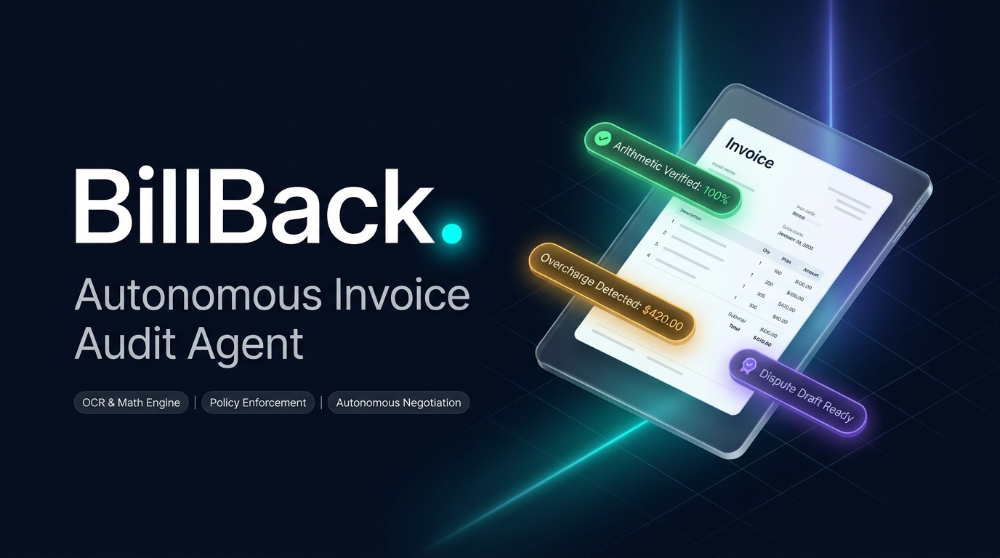
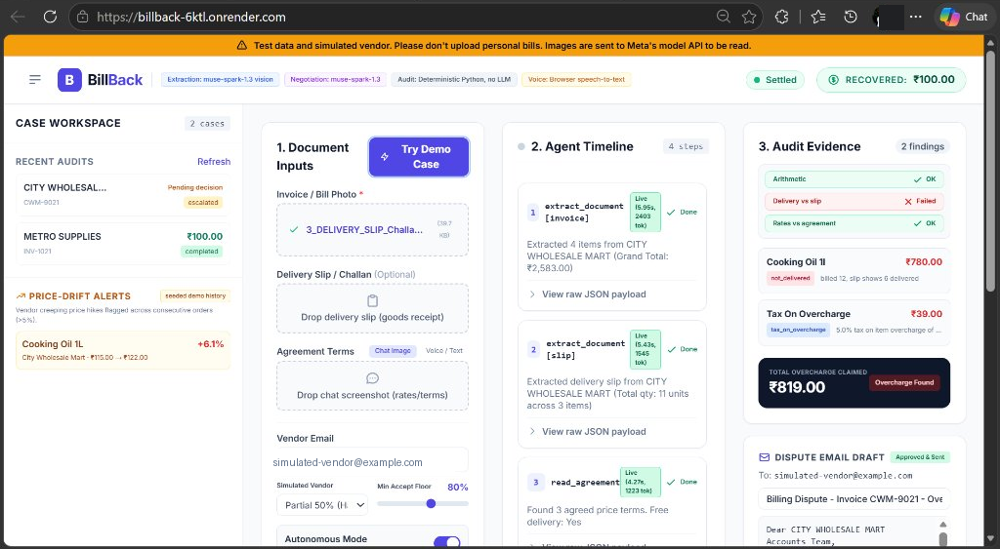
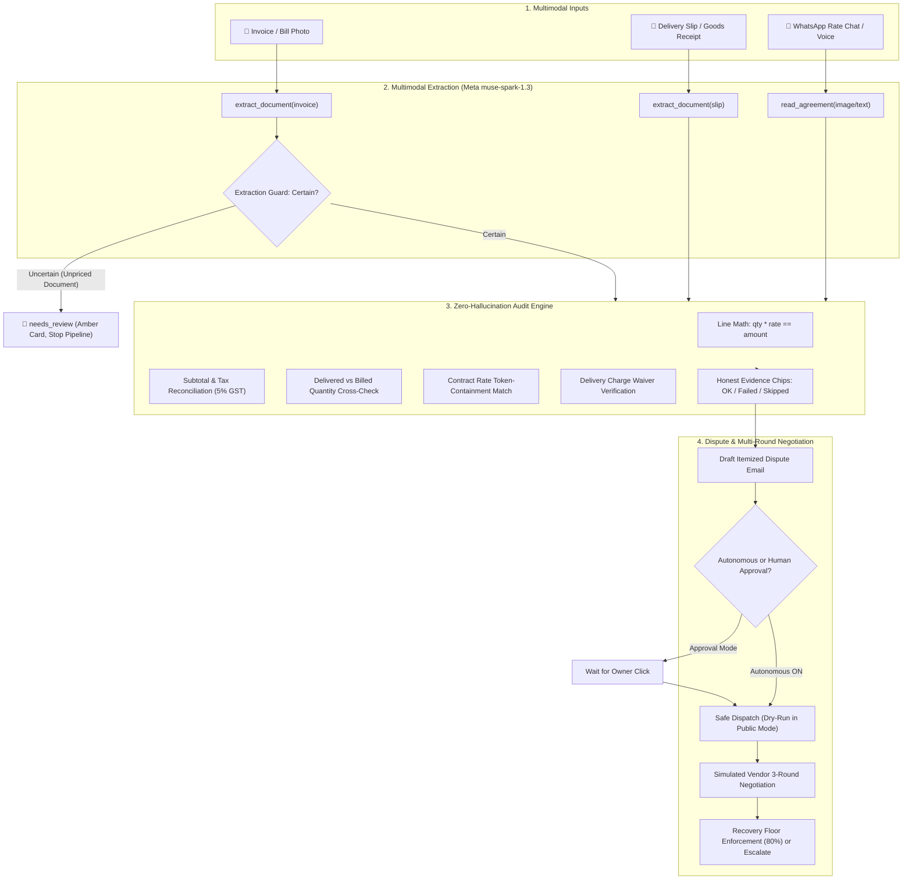

<div align="center">
  

  # 🧾 BillBack
  ### Autonomous Invoice Audit, Multimodal Cross-Referencing & Vendor Negotiation Agent

  <p align="center">
    <i>Small shops lose hard-earned cash because agreements live in WhatsApp chats, proof of delivery is a paper challan, and invoices are photos. BillBack cross-checks all three, mathematically proves every discrepancy without hallucination, and autonomously negotiates settlement credit notes.</i>
  </p>

  <p align="center">
    <a href="https://billback-6ktl.onrender.com"></a>
    <a href="https://github.com/Manasa-L-Hegde/billback"></a>
    
    
    
  </p>

  <p align="center">
    <a href="https://billback-6ktl.onrender.com"><b>🌐 Live Deployed App</b></a> &nbsp;•&nbsp;
    <a href="#-the-problem-real-world-small-business-discrepancies">💡 The Problem</a> &nbsp;•&nbsp;
    <a href="#-30-second-architecture-flow">📐 Architecture</a> &nbsp;•&nbsp;
    <a href="#-agent-capabilities--guardrails">🛡️ Guardrails</a> &nbsp;•&nbsp;
    <a href="#-one-click-demo-walkthrough">⚡ Demo Walkthrough</a> &nbsp;•&nbsp;
    <a href="#-real-photo-accuracy--benchmarks">📊 Accuracy</a>
  </p>
</div>

---

## 📸 Live Web Application

<div align="center">
  <a href="https://billback-6ktl.onrender.com">
    
  </a>
  <p><i>Live interface running on Render with active Server-Sent Events (SSE) streaming timeline, evidence chips, and price-drift monitor.</i></p>
</div>

---

## 💡 The Problem: Real-World Small Business Discrepancies

Small retailers, restaurants, and kirana stores process dozens of supplier orders every week. They do not operate enterprise ERPs like SAP or Oracle. Instead:

| Fragmented Reality | What Actually Happens | How BillBack Solves It |
| :--- | :--- | :--- |
| **Agreed Rates** | Negotiated casually via WhatsApp messages or voice notes. | Meta **muse-spark-1.3** extracts exact item prices and freight waivers from screenshots or voice transcripts. |
| **Proof of Delivery** | A crumpled, handwritten paper challan stamped upon truck arrival. | Vision OCR extracts delivered quantities line-by-line. |
| **Tax Invoices** | Printed or digital photos sent days later with sneaky price hikes or duplicate line items. | Cross-references invoice lines against both delivery slips and agreed rate cards. |
| **Financial Calculations** | Store owners rarely compute line arithmetic or calculate compounding GST on overcharges. | **Deterministic Python Engine**: Line math, tax calculation, and subtotals are audited with 0% risk of LLM hallucinations. |
| **Disputes & Recovery** | Owners lack time to draft emails, follow up, and negotiate counter-offers. | Autonomous agent drafts formal dispute emails and conducts multi-round negotiations with simulated vendors. |

---

## 📐 30-Second Architecture Flow



---

## 🛡️ Agent Capabilities & Guardrails

### 1. Zero-Hallucination Money Math
* **LLMs should never do financial arithmetic.** In BillBack, Meta's `muse-spark-1.3` is used strictly for what it excels at: **document vision perception** and **natural language negotiation**.
* All overcharge mathematics, line multiplications (`qty * rate`), subtotal additions, and 5% tax-on-overcharge calculations are handled by **deterministic Python functions**.

### 2. The Refusal Guardrail ("Knowing When It Can't")
* If a document has missing rates, null totals, or is completely unpriced (such as a logistics shipping label like `hck.jpeg`), the **Extraction Guard** refuses to guess.
* The agent halts immediately into `needs_review` status and surfaces a prominent **Amber Card**: *"Couldn't read this bill reliably — zero emails drafted"*.

### 3. Multi-Round Negotiation Loop with Floors
* Negotiates with vendors up to a strict **3-round limit**.
* Enforces a configurable **Recovery Floor** (default 80%). If a vendor offers less (e.g. 50% goodwill credit), the agent counters with delivery challan evidence. If the floor is still not met after 3 rounds, the case cleanly **escalates to human decision** with **Recovered: ₹0.00**.

### 4. Continuous Price-Drift Alerts
* Background analytics engine tracks historical purchase prices across orders.
* Flags suppliers who quietly inflate item prices across consecutive deliveries (> 5% drift).

---

## ⚡ One-Click Demo Walkthrough

Try the live demo at **[https://billback-6ktl.onrender.com](https://billback-6ktl.onrender.com)**:

1. Click the prominent **"Try Demo Case"** button.
2. Watch the live SSE timeline stream in real-time (~400ms visual pacing):
   - **Step 1 & 2**: Vision OCR extracts City Wholesale Mart invoice and signed delivery challan.
   - **Step 3**: WhatsApp rate agreement is extracted.
   - **Step 4**: Deterministic audit calculates:
     $$\text{Cooking Oil (6 undelivered units} \times ₹130.00) = ₹780.00$$
     $$+ 5\% \text{ GST on overcharge} = ₹39.00$$
     $$\mathbf{\text{Total Overcharge Claimed} = ₹819.00}$$
   - **Step 5**: Formal dispute email drafted with line-item arithmetic proof.
   - **Step 6 (Negotiation)**: Simulated vendor offers 50% (₹409.50); agent counters twice with evidence; vendor stays at 50%; agent halts at Round 3 and **escalates to owner**.
   - **Outcome Card**: `{Claimed: ₹819.00, Recovered: ₹0.00, Status: "Vendor offer Rs. 409.5, awaiting your decision"}`.

---

## 🧪 Four Verified Scenarios

Run end-to-end via `.venv\Scripts\python verify_three_scenarios.py`:

| Scenario | Vendor Strategy | Negotiation Outcome | Final Status |
| :--- | :--- | :--- | :--- |
| **1. Accept** | Immediate Concession | Vendor concedes 100% in Round 1 | **Settled**: ₹819.00 recovered |
| **2. Partial 50%** | Hard 50% Cap | Agent counters twice; hits 80% floor | **Escalated**: ₹0.00 recovered (awaiting owner) |
| **3. Deny** | Disputed Dispatch | Agent counters with signed challan proof | **Escalated**: ₹0.00 recovered (sent to human collection) |
| **4. Approval Mode** | Autonomous OFF | Halts before email dispatch | **Awaiting Approval**: Waits for manual owner click |

---

## 📊 Real-Photo Accuracy & Benchmarks

BillBack was evaluated across real consumer and commercial receipts (documented in [`samples/accuracy.md`](samples/accuracy.md)):

| File | Document Category | Extracted Vendor | Billed Total | Extracted Total | Items Match | Notes |
| :--- | :--- | :--- | :--- | :--- | :--- | :--- |
| `real1.jpg` | Utility / Electricity | Hubli Electricity (HESCOM) | ₹238.00 | ₹238.00 | 1/1 (100%) | Account ID 912796, exact match |
| `real2.jpg` | Food Delivery Slip | Sri Skanda Sagar (Zomato) | ₹160.00 | ₹160.00 | 1/1 (100%) | Veg Fried Rice @ ₹160, tape partially obscures header |
| `real3.jpg` | Mobile Recharge (GPay) | Jio Prepaid | ₹800.90 | ₹800.90 | 2/2 (100%) | Plan ₹799 + Platform fee ₹1.90 |
| `real4.jpg` | Pharmacy Tax Invoice | Netmeds India Ki Pharmacy | ₹3,732.00 | ₹3,732.00 | 4/4 (100%) | 4 prescription drugs, discount of ₹883.10 reconciled |
| `real5.png` | E-Commerce Fee Invoice | Flipkart Internet Pvt Ltd | ₹10.00 | ₹10.00 | 6/6 (100%) | 6 platform fee line items + ₹1.54 GST |
| `hck.jpeg` | Logistics Shipping Label | Campus Activewear | *Unpriced* | *Refused* | 0/1 (0%) | **Extraction Guard Triggered**: Marked `uncertain`, pipeline safely halted |

---

## 🔒 Public Mode Security (`PUBLIC_MODE=1`)

When hosted publicly on Render, BillBack activates military-grade privacy and safety controls:
* **Forced Email Dry-Run**: Real emails are never dispatched. Recipient addresses from user input are discarded, and no SMTP credentials exist on the server.
* **Visitor Session Isolation**: Each visitor is assigned an `HttpOnly` session cookie. A user's uploaded cases and SSE event streams are strictly hidden from all other visitors (HTTP 403 on cross-session access).
* **Zero-Persistence Disk**: Uploaded case images are verified by content magic bytes (renamed `.exe` rejected with HTTP 400), limited to 5 MB, and **completely purged from disk** immediately after the audit finishes.
* **Rate Limits & Budget Protection**: Custom audits capped at 5 cases/hr/IP, demo runs at 30 cases/hr/IP, and a global hard ceiling of **150 cases/day** to prevent API cost overruns.

---

## 💻 Quickstart: Run Locally

```bash
# 1. Clone the repository
git clone https://github.com/Manasa-L-Hegde/billback.git
cd billback

# 2. Create and activate virtual environment
python -m venv .venv
# On Windows:
.venv\Scripts\activate
# On Linux/macOS:
source .venv/bin/activate

# 3. Install pinned dependencies
pip install -r requirements.txt

# 4. Configure environment
cp .env.example .env
# Edit .env and set META_API_KEY=your_key_here

# 5. Launch web application
uvicorn server:app --reload
```
Open **`http://127.0.0.1:8000`** in your browser.

---

## 🔍 Meta Model Products Used
* **`muse-spark-1.3` (Vision & Multimodal Document Intelligence)**: Powers all invoice, paper slip, and chat rate extraction via `https://api.meta.ai/v1`.
* **`muse-spark-1.3` (Autonomous Negotiation Reasoning)**: Generates context-aware vendor replies and counter-offer arguments.
* **Web Speech API**: In-browser speech-to-text for multilingual voice rate agreement capture (English, Hindi, Kannada).

---

<div align="center">
  <sub>Developed for the Meta Advanced Agentic Coding Hackathon · November 2026</sub>
</div>
