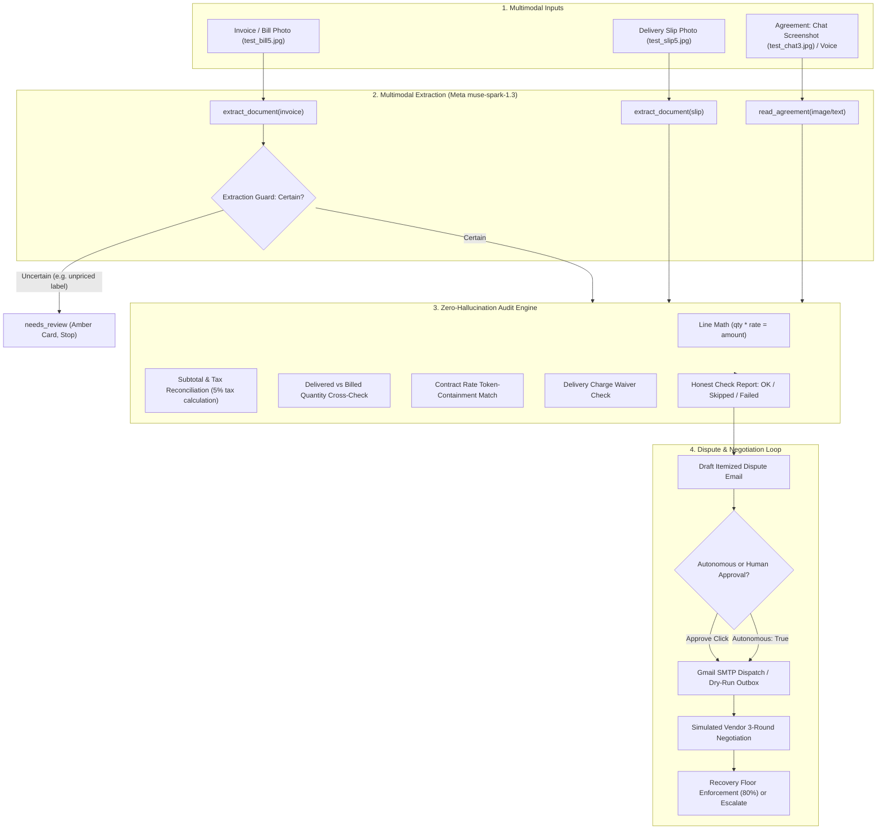

# BillBack

> Small shops and families pay bills where the real agreement lives in a voice note or chat, the proof of delivery is a paper slip, and the bill is a photo. There is no ERP and no contract management system. Overcharges slip through—arithmetic mistakes, surprise charges nobody agreed to, items billed twice or never delivered—because auditing requires cross-referencing three messy, fragmented sources by hand, and disputing requires drafting, calculating, and chasing emails. BillBack is an autonomous agent that reads all three sources, mathematically proves each overcharge, drafts an evidence-backed dispute, and carries multi-round negotiation through to recovery.

---

## 30-Second Architecture: How It Works



---

## Live Demo (Public Deployment)

- **Live URL**: `https://billback.onrender.com` *(Placeholder for Render public deployment)*
- **Public Mode Safety (`PUBLIC_MODE=1`)**:
  - **Zero SMTP / Email Dry-Run**: Outbound emails are strictly forced to dry-run logging. The recipient address is never taken from user input and is overridden to `simulated-vendor@example.com`. Gmail SMTP credentials are never stored or accessed on the public server.
  - **Disabled Destructive Endpoints**: Administrative and reset endpoints (`/api/dev/reset`, `?dev=1`) are disabled and return HTTP 403 Forbidden.
  - **Strict Upload Hygiene**: Only JPG, PNG, and WebP images up to 5 MB are accepted (verified by file content and magic bytes). Executables and oversized payloads are rejected immediately with friendly HTTP 400 / 413 responses. All uploaded case files are automatically deleted from disk when the case completes.
  - **Rate Limits & Cost Budget Cap**: Limited to 5 cases per IP per hour, and a global daily cap of 150 cases per day to control Meta API costs. When the daily limit is reached, a friendly banner directs judges to the cached replay or video walkthrough.
  - **Fixed Notice Banner**: Always displays `"⚠️ Test data and simulated vendor. Please don't upload personal bills. Images are sent to Meta's model API to be read."`
  - **Cold Start Handling**: Lightweight frontend loads in < 1s; pings `GET /health` and displays a subtle `"Waking up the demo server..."` indicator during Render free-tier spin-up, enabling buttons as soon as the service is warm.

---

## Quickstart (Fresh Clone Setup)

1. **Clone the repository**:
   ```bash
   git clone https://github.com/Manasa-L-Hegde/billback.git
   cd billback
   ```

2. **Create virtual environment & install dependencies**:
   ```bash
   python -m venv .venv
   # Windows:
   .venv\Scripts\activate
   # macOS/Linux:
   source .venv/bin/activate

   pip install -r requirements.txt
   ```

3. **Configure environment variables**:
   Create a `.env` file from `.env.example`:
   ```bash
   cp .env.example .env
   ```
   Edit `.env`:
   ```env
   MODEL_API_KEY=your_meta_model_api_key_here
   # Optional: Real Gmail sending (defaults to DRY_RUN=1 audit outbox logging)
   DRY_RUN=1
   GMAIL_USER=your_email@gmail.com
   GMAIL_APP_PASSWORD=your_16_char_app_password
   DEMO_VENDOR_EMAIL=vendor_inbox@example.com
   ```

4. **Launch the Web Application**:
   ```bash
   uvicorn server:app --reload
   ```
   Open `http://127.0.0.1:8000` in your browser.

---

## How to Try the Demo Case (One-Click)

1. Open `http://127.0.0.1:8000`.
2. Click the prominent **"Try Demo Case"** button in the inputs section.
   - Automatically loads `test_bill5.jpg` (City Wholesale Mart invoice), `test_slip5.jpg` (delivery challan), and `test_chat3.jpg` (rate agreement).
   - Sets vendor behavior to **Partial 50%**, recovery floor to **80%**, and **Autonomous Mode** to ON.
   - Features **Demo Pacing (~400ms)** enabled by default so each stage is clearly observable during video recording and live presentation.
   - Live timeline streams via Server-Sent Events (SSE):
     - **Audit Findings**: Cooking Oil 1L duplicate billed (12 billed vs 6 delivered = Rs. 780.00) + 5% tax on overcharge (Rs. 39.00) = **Rs. 819.00 Total Claimed**.
     - **Evidence Chips**: Arithmetic `[OK]`, Delivery `[FAILED]`, Agreement `[OK]`.
     - **Dispute Email**: Formatted with line-item arithmetic proof sent to vendor.
     - **Multi-Round Negotiation**: Simulated vendor offers Rs. 409.50 (50%); agent counters with challan proof; agent escalates or settles according to user's configured floor.
     - **Outcome Card**: Displays `{claimed: 819.0, recovered: 0.0, rounds: 3, status: "Vendor offer Rs. 409.5, awaiting your decision"}` (escalates cleanly to owner because the simulated vendor's 50% offer fails to reach the user's 80% recovery floor).

---

## Public Deployment & Security Hardening (`PUBLIC_MODE=1`)

For hackathon evaluation and public hosting (e.g. on Render), BillBack includes an environment switch `PUBLIC_MODE=1`:
- **Forced Email Dry-Run**: All dispute email dispatch is strictly forced to dry-run mode (`simulated-vendor@example.com`). Real emails are never sent, recipient addresses from user input are ignored, and no SMTP/Gmail credentials are required on the host.
- **Visitor Isolation**: Each visitor is assigned an `HttpOnly` session cookie (`bb_session`). Case history, live SSE streams (`/api/cases/{id}/stream`), and settlement approval actions are strictly isolated to the session that created them. Attempting to view or approve another session's case yields `HTTP 403 Forbidden`. Price-drift alerts remain globally accessible (clearly labeled `seeded=true`).
- **Upload Hardening & Zero-Persistence Disk**:
  - Accepts only JPG, PNG, and WebP images up to 5 MB.
  - File types are validated using content inspection (magic bytes); renamed executables (`.exe` renamed to `.jpg`) are rejected with `HTTP 400`.
  - In public mode, uploaded case files are completely purged from disk immediately upon completion of the case pipeline.
- **Rate Limiting & Threat Model**:
  - Custom bill audits are limited to 5 cases/hour/IP, and Demo cases to 30 cases/hour/IP.
  - Client IPs are keyed from the reverse-proxy `X-Forwarded-For` header. Because client-supplied `X-Forwarded-For` headers could theoretically be spoofed if an upstream reverse-proxy does not sanitize them, this is treated as a polite throttling convention rather than an unbreakable boundary.
  - **The Real Backstops**: The application enforces a strict global hard cap of **150 cases per day** across all visitors (returning a friendly banner to watch the demo video or explore cached replays once reached), backed by a hard Meta API usage budget alert.
- **Disabled Endpoints**: Destructive endpoints (e.g., `/api/dev/reset` and `?dev=1`) are disabled under `PUBLIC_MODE=1`.

---

## Three Verified Scenarios

BillBack includes 4 verified end-to-end scenarios run via `.venv\Scripts\python verify_three_scenarios.py`:
1. **Accept**: Simulated vendor accepts the evidence immediately in Round 1 and issues a full credit note (Rs. 819.00 recovered).
2. **Partial 50%**: Simulated vendor offers 50% (Rs. 409.50). The agent counters for 3 rounds presenting arithmetic proof, and safely escalates to the owner when the vendor does not reach the 80% floor.
3. **Deny**: Simulated vendor disputes dispatch. The agent counters across 3 rounds with signed delivery challan proof before escalating to human collection.
4. **Approval Mode**: Autonomous mode OFF. Dispute email halts in `Awaiting approval` state until user inspects, edits, and clicks "Approve".

---

## Honesty and Limitations

- **Synthetically Generated Test Data**:
  - Sample invoices (`test_bill1.jpg` through `test_bill6.jpg`), delivery slips (`test_slip*.jpg`), and chat screenshots (`test_chat1.jpg` through `test_chat3.jpg`) are synthetic test fixtures designed with known, planted discrepancies to measure audit accuracy.
  - The 4 historical invoices for *City Wholesale Mart* shown in the sidebar price-drift monitor are seeded test records (`seeded=true`) to demonstrate the consecutive price-drift detection algorithm.
- **Simulated Vendor**:
  - In-app vendor responses are generated by a simulation module (`vendor_sim.py`) strictly labeled `"Simulated vendor"` for predictable demonstration of counter-offers and escalations.
- **Voice Agreement Input**:
  - Voice agreements utilize the browser's native Web Speech API (supporting Indian English, Hindi, and Kannada) to produce a local transcript, which is subsequently parsed into structured contract rates by `muse-spark-1.3`. Meta's `input_audio` multimodal format was evaluated and is currently unsupported on the standard chat completions endpoint.
- **Real-Photo Accuracy & The `hck.jpeg` Failure**:
  - Tested across 5 real bills (14 line items, 100% accurate match; mostly printed or digital receipts including Zomato slips, Google Pay receipts, Netmeds tax invoices, and Flipkart invoices; physical handwritten chits remain untested; documented in `samples/accuracy.md`).
  - **Honest Failure Handling**: When tested with `samples/real/hck.jpeg` (a Campus Activewear Flipkart shipping label containing an item name but zero prices or totals), initial extraction hallucinated a 0.00 clean bill. We engineered an **Extraction Guard** (`extract.py`): bills with missing rates or null grand totals are marked `uncertain`, halting the pipeline into `needs_review` without drafting emails.
- **What BillBack Cannot Do**:
  - It does not file legal court claims or initiate legal debt collection.
  - It does not connect directly to banking rails for automated wire reversals; settlements are documented as credit notes or revised tax invoices.

---

## Meta Model Products Used
- **`muse-spark-1.3`**: Powers all document vision understanding (printed bills, handwritten chits, delivery slips, chat screenshots), structured JSON extraction, and agreement rate parsing via `https://api.meta.ai/v1`.
